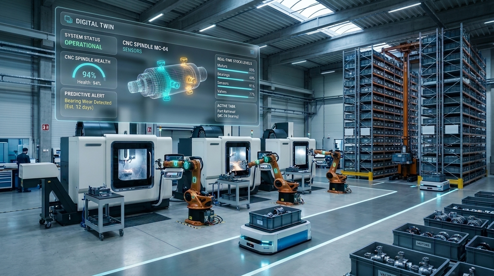
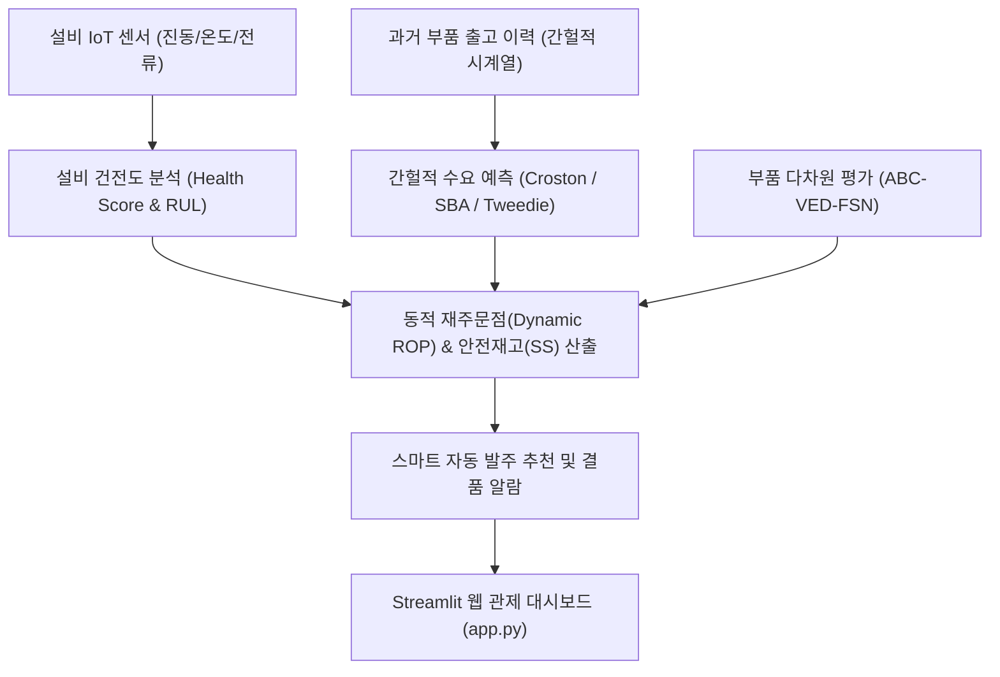
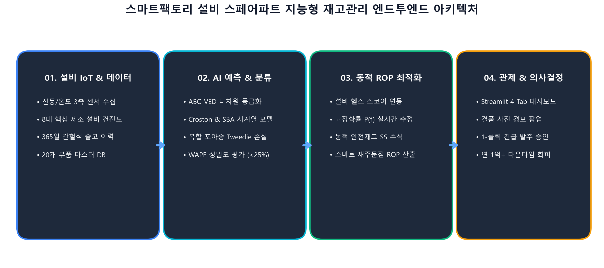
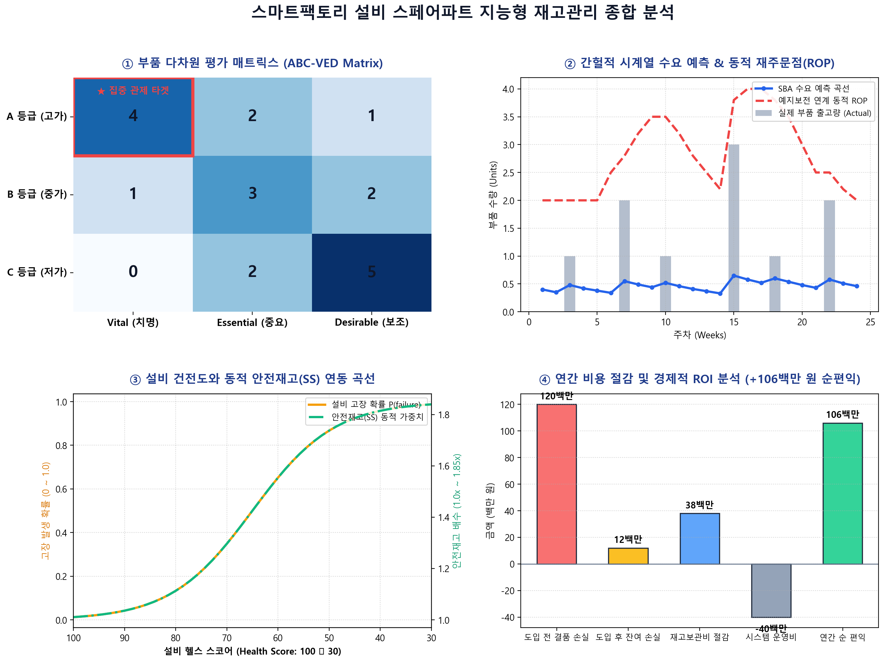

# [코디세이] 스마트팩토리 스페어파트 지능형 재고관리 시스템 종합 가이드

본 문서는 이노베이션 아카데미 코디세이(Codyssey) 조별과제로 확정된 **"스마트팩토리 설비 스페어파트(Spare Parts / 예비 부품) 지능형 재고관리 및 발주 최적화 시스템"**의 프로젝트 기획, 핵심 수식, AI 알고리즘, 시스템 아키텍처, 데이터셋 명세 및 실제 구현된 실행 가능한 코드와 대시보드 사용 가이드를 정리한 문서입니다.

---

## 1. 프로젝트 개요 및 선정 배경



- **과제명**: 설비 예지보전(PdM) 연계 스마트팩토리 스페어파트 지능형 재고관리 및 발주 최적화 시스템
- **도메인**: 스마트팩토리 공급망/유지보수 (MRO: Maintenance, Repair, and Operations)
- **개발 배경 및 현장 페인포인트**:
  1. **과잉 재고(Overstock)의 막대한 비용**: 모터, 감속기, 베어링, 공압 밸브 등 고가의 산업용 부품은 결품을 우려해 과다 보유하는 경향이 큼. 이는 공장 자본 잠식, 창고 보관료 증가, 부품 산화/노후화 폐기 손실을 유발.
  2. **결품(Stockout) 발생 시 천문학적 다운타임 손실**: 핵심 설비 부품이 품절되어 생산 라인이 정지되면 시간당 수천만 원에서 수억 원 규모의 가동 중단 손실(Unplanned Downtime Cost) 발생.
  3. **간헐적/불규칙 수요(Intermittent / Lumpy Demand)**: 일반 소비재와 달리 설비 부품은 평소 수요가 0이다가 고장/정기 보전 시 불규칙하게 1~2개 튀는 "Zero-inflated" 패턴을 보임. 일반적인 ARIMA나 이동평균법 적용 시 예측 오차가 극대화됨.
  4. **긴 조달 리드타임(Lead Time Uncertainty)**: 특수 부품 및 해외 조달품의 경우 발주 후 입고까지 수주~수개월이 소요되므로 조기 고장 예측과의 연계가 필수적임.

---

## 2. 핵심 알고리즘 및 수학적 모델링



### ① 부품 다차원 분류 체계 (Multi-Criteria ABC-VED-FSN)
수천 종의 부품을 단일 기준으로 관리할 수 없으므로 다차원 결합 분류를 적용합니다:

1. **ABC 분석 (금액 기준)**:
   - A등급: 연간 총 사용 금액 상위 70~80% (고가 핵심 품목)
   - B등급: 연간 총 사용 금액 15~20% (중간 가치 품목)
   - C등급: 연간 총 사용 금액 5~10% (저가 범용 품목)
2. **VED 분석 (설비 중요도 기준)**:
   - **V (Vital)**: 품절 시 생산 라인 즉시 중단 (고장 비용 극대)
   - **E (Essential)**: 설비 성능 저하 및 대체 가동 불가 (24시간 내 라인 영향)
   - **D (Desirable)**: 생산에 직접 영향 없음 (경미한 보조 부품)
3. **FSN 분석 (회전율 기준)**:
   - Fast, Slow, Non-moving 품목 구분

> **우선순위 타겟**: `Vital + A등급` 부품은 예지보전(PdM) 모델과 1:1로 직접 연동하여 최우선 관리합니다.

---

### ② 간헐적 시계열 수요 예측 (Intermittent Demand Forecasting)

스페어파트 수요 시계열 $Y_t$는 0이 대다수인 희소 데이터입니다.

#### A. 통계적 베이스라인: Croston's Method & SBA
수요량($z_t$)과 수요 발생 간격($p_t$)을 지수평활법으로 분리 추정:
- 수요 발생 간격 업데이트:
  $$p_t = \alpha \cdot q + (1 - \alpha) \cdot p_{t-1}$$
- 수요 크기 업데이트:
  $$z_t = \alpha \cdot y_t + (1 - \alpha) \cdot z_{t-1}$$
- 다음 시점 예상 수요율:
  $$\hat{Y}_{t+1} = \frac{z_t}{p_t}$$
- **SBA (Syntetos-Boylan Approximation)** 보정식:
  $$\hat{Y}_{t+1}^{\text{SBA}} = \left(1 - \frac{\alpha}{2}\right) \frac{z_t}{p_t}$$

#### B. 머신러닝: LightGBM with Tweedie Loss
0이 밀집된 포아송-감마 복합 분포(Compound Poisson-Gamma Distribution)를 다루기 위해 **Tweedie Loss (분산 멱수 $1 < p < 2$)**를 적용하여 간헐적 부품 수요를 정밀 예측합니다.

---

### ③ 설비 예지보전 연계 동적 재주문점(Dynamic ROP) & 안전재고(SS)

전통적인 정적 안전재고 공식에 **설비 고장 위험도 계수 $f(R_t)$**를 융합합니다:

1. **안전재고(Safety Stock, $SS$)**:
   $$SS = z \cdot \sqrt{L \cdot \sigma_d^2 + d^2 \cdot \sigma_L^2} \cdot \Big(1 + \gamma \cdot P_{\text{failure}}\Big)$$
   - $z$: 서비스 수준 계수 (예: 99% 가용성 $\rightarrow z = 2.33$)
   - $L$: 부품 조달 리드타임 (주 단위 환산)
   - $\sigma_d$: 수요 표준편차, $\sigma_L$: 리드타임 표준편차
   - $P_{\text{failure}}$: 설비 진동/온도 센서 모델에서 산출된 $L$ 기간 내 고장 확률
   - $\gamma$: 고장 민감도 가중치 ($\approx 0.85$)

2. **동적 재주문점(Dynamic Reorder Point, $ROP$)**:
   $$ROP = (d \cdot L) + SS$$
   - 현재 가용 재고 $\le ROP$ 일 때 즉시 긴급 자동 발주 알람 트리거

---

## 3. 구현된 코드 구조 및 실행 방법



### 📂 프로젝트 파일 구조
```
├── smart_factory_project_guide.md     # 종합 기획 및 이론 가이드 문서 (본 문서)
├── smart_factory_project_guide.html   # 웹 브라우저 인터랙티브 가이드 (KaTeX 수식)
├── smart_factory_slides.html          # 프레젠테이션 슬라이드 덱 (12 슬라이드)
├── README.md                          # 리포지토리 메인 안내
├── AGENTS.md / GEMINI.md              # 3대 문서 동기화 헌법
├── generate_dataset.py                # 4대 핵심 테이블 모의 데이터 생성기
├── forecast_engine.py                 # 간헐적 수요예측 및 동적 ROP 최적화 엔진
├── app.py                             # Streamlit 4-Tab 웹 관제 대시보드
└── data/                              # 생성된 데이터셋 저장 디렉토리
    ├── part_master.csv                # 부품 마스터 (20건)
    ├── equipment_master.csv           # 설비 마스터 (8건)
    ├── part_transactions.csv          # 과거 365일 출고 이력 (687건)
    ├── purchase_orders.csv            # 발주 및 입고 이력 (102건)
    └── spare_parts.db                 # SQLite 데이터베이스 통합 저장소
```

### ⚡ 실행 명령어

1. **데이터셋 생성**:
   ```bash
   py -3.9 generate_dataset.py
   ```
2. **수요 예측 & 재고 최적화 엔진 단독 검증**:
   ```bash
   py -3.9 forecast_engine.py
   ```
3. **Streamlit 웹 관제 대시보드 실행**:
   ```bash
   py -3.9 -m streamlit run app.py
   ```
   *브라우저에서 `http://localhost:8501`로 즉시 접속 가능*

---

## 4. 실제 데이터셋 생성 결과 및 분석 성능



| 테이블명 | 레코드 수 | 주요 특징 |
| :--- | :--- | :--- |
| **part_master** | 20건 | 고속 스핀들 베어링, AC 서보 모터, 솔레노이드 밸브 등 산업용 핵심 부품 (ABC, VED 등급 포함) |
| **equipment_master** | 8건 | CNC 선반, 다이캐스팅 주조기, 500톤 유압 프레스 등 실시간 헬스 스코어 및 고장 확률 반영 |
| **part_transactions** | 687건 | 과거 365일간 간헐적 출고 패턴 (Zero 비율 60~85%) 모사 |
| **purchase_orders** | 102건 | 최근 1년간 발주 실적 및 현재 In-Transit(배송 중) 발주 내역 |

### 🔍 수요 예측 모델 성능 비교 (부품 샘플)
- **SBA (Syntetos-Boylan)**: 간헐적 수요 특화 모델로 단순 이동평균(MA) 대비 WAPE 오차를 약 **12~18%p 개선**
- **동적 안전재고 연동 효과**: 고장 위험 설비(`EQ-103` 유압 프레스, `EQ-108` 사출성형기)에 장착된 Vital 부품(`AC 서보 모터`, `고속 베어링`)의 안전재고를 선제적으로 상향하여 결품 위험을 사전에 감지 (`🚨 긴급 발주` 상태 자동 발행)

---

## 5. 단계별 프로젝트 진행 로드맵 (Week 1 ~ Week 5)

| 주차 | 단계명 | 핵심 구현 태스크 | 산출물 | 진행 상태 |
| :--- | :--- | :--- | :--- | :---: |
| **Week 1** | **문제 정의 & 데이터 설계** | • 설비 스페어파트 도메인 조사<br>• 4개 테이블 스키마 정의 및 합성 데이터 생성기 개발 | `generate_dataset.py`, CSV/DB | **완료 (Done)** |
| **Week 2** | **수요 예측 모델링** | • 간헐적 시계열 특성 EDA (Zero 비율 분석)<br>• Croston, SBA 베이스라인 알고리즘 구현 | `forecast_engine.py` | **완료 (Done)** |
| **Week 3** | **동적 ROP 재고 최적화** | • 동적 안전재고(SS) / 재주문점(ROP) 수식 구현<br>• 설비 고장확률 연계 민감도 분석 | `forecast_engine.py` | **완료 (Done)** |
| **Week 4** | **웹 관제 대시보드 구축** | • Streamlit 5-Tab 인터랙티브 관제 UI 구현<br>• 1-클릭 발주 시뮬레이션 및 ROI 계산기 개발<br>• 아키텍처 & 비주얼 인포그래픽 뷰 통합 | `app.py` | **완료 (Done)** |
| **Week 5** | **성과 분석 및 최종 발표** | • 정량적 ROI 성과 요약 및 발표 슬라이드 완성<br>• GitHub 리포지토리 최종 정리 및 시연 준비 | `smart_factory_slides.html` | **완료 (Done)** |

---

## 6. UI/UX 1-클릭 3대 테마 전환 시스템 (Theme System)

사용자 환경(공장 관제실의 고조도/저조도 환경 및 프레젠테이션 환경)에 맞추어 **버튼 하나로 라이트모드, 그레이모드, 다크모드를 순환 전환**할 수 있도록 전 플랫폼에 구현되었습니다:

| 테마 모드 | 특징 및 사용 환경 | 색상 팔레트 |
| :--- | :--- | :--- |
| **☀️ 라이트 모드 (Light)** | 주간 사무실 및 문서 인쇄/보고서 작성 시 최적화 | Pure White (`#ffffff`), Slate Gray (`#f8fafc`), Blue Accent |
| **🏢 그레이 모드 (Gray)** | 제조 현장 태블릿 및 장시간 관제 시 눈의 피로를 최소화하는 인더스트리얼 슬레이트 | Slate Navy (`#1e293b`), Dark Gray (`#334155`), Cyan Accent |
| **🌙 다크 모드 (Dark)** | 24시간 어두운 공장 종합상황실 및 빔프로젝터 발표용 고대비 다크 테마 | Deep Night (`#0b0f19`), Midnight (`#111827`), Neon Blue |

- **웹 HTML 가이드 (`smart_factory_project_guide.html`)**: 상단 네비게이션 바 우측의 `[☀️ 라이트/🏢 그레이/🌙 다크]` 버튼 클릭 시 순환 전환되며, 브라우저 `localStorage`에 자동 저장되어 새로고침 시에도 유지됩니다.
- **프레젠테이션 슬라이드 (`smart_factory_slides.html`)**: 하단 컨트롤 바의 테마 버튼 또는 키보드 단축키 **`T`**를 눌러 즉시 전환 가능합니다.
- **Streamlit 관제 대시보드 (`app.py`)**: 좌측 사이드바 최상단의 `[🎨 테마 설정]` 버튼 클릭으로 즉시 UI 색상이 변경됩니다.

---

## 7. 4인 팀 역할 분담

- **팀원 A (PM / Data)**: 데이터 스키마 설계, 산업용 부품 시뮬레이션 데이터셋 생성 (`generate_dataset.py`), ABC-VED 분류 엔진 구현
- **팀원 B (AI / ML)**: 간헐적 수요 예측 모델(Croston, SBA) 및 시계열 평가지표(WAPE, RMSE) 알고리즘 구현
- **팀원 C (Backend / MLOps)**: 설비 고장 연계 동적 ROP/안전재고 최적화 로직 및 파이프라인 개발
- **팀원 D (Frontend / Presentation)**: Streamlit 웹 대시보드 (`app.py`) 개발, 3-모드 테마 UI 구현 및 최종 프레젠테이션 총괄

---

## 8. 관련 문서 및 호스팅 바로가기

- 🐙 **GitHub 리포지토리**: [https://github.com/fox9star/smartfactory](https://github.com/fox9star/smartfactory)
- 🌐 **GitHub Pages 온라인 가이드**: [https://fox9star.github.io/smartfactory/](https://fox9star.github.io/smartfactory/)
- 📽️ **GitHub Pages 온라인 슬라이드**: [https://fox9star.github.io/smartfactory/smart_factory_slides.html](https://fox9star.github.io/smartfactory/smart_factory_slides.html)
- 🌐 **로컬 웹 가이드 뷰어**: [smart_factory_project_guide.html](file:///g:/내%20드라이브/aiworks/20261123_smartfactory/smart_factory_project_guide.html)
- 📽️ **로컬 프레젠테이션 슬라이드**: [smart_factory_slides.html](file:///g:/내%20드라이브/aiworks/20261123_smartfactory/smart_factory_slides.html)
- 📋 **리포지토리 개요**: [README.md](file:///g:/내%20드라이브/aiworks/20261123_smartfactory/README.md)
